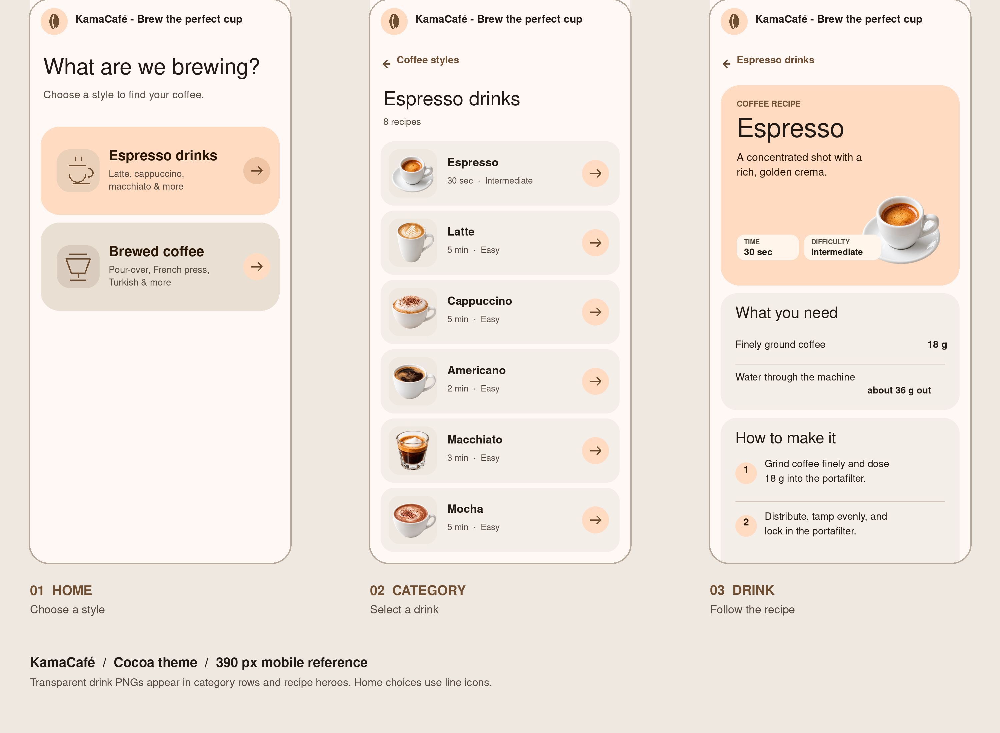

# KamaCafé — visual implementation spec

**Goal:** Build a mobile-first coffee recipe app with three views: home, coffee category, and drink recipe. The visual reference below is shown at a **390 × 844 CSS-pixel viewport**. The Cocoa color kit and the existing two-step navigation are intentional. The mockup illustrates layout; recipe times, difficulty, counts, and amounts must come from the current catalog.



This spec is for implementation. Use `catalog.json` as the content source and `images/{id}.png` as the transparent illustration for each drink.

## 1. Screen flow and routes

| View | URL | Main action | Back action |
|---|---|---|---|
| Home | `/` | Choose **Espresso drinks** or **Brewed coffee** | — |
| Category | `/#category-{category.id}` | Choose a drink | Return to home |
| Drink | `/#${drink.id}` | Read ingredients and steps | Return to its category |

For the current catalog, the category URLs are `/#category-espresso-drink` and `/#category-brewed-coffee`; Espresso is `/#espresso`. Derive links from stable catalog IDs. Directly opening or refreshing any URL must render the corresponding view. Browser Back/Forward must follow the same progression. An unknown or removed ID shows an unavailable-page message and a link home. Keep scroll at the top after each view change.

## 2. Shared visual system

**Material 3 direction:** rounded cards, tonal surfaces, clear type hierarchy, large touch targets, visible states, and semantic color roles. Use the [Material Design 3 guidance](https://m3.material.io/) as the component reference; preserve the chosen Cocoa colors below.

| Token | Value | Use |
|---|---|---|
| `primary` | `#6F4E32` | Back link, accents, focus ring |
| `on-primary` | `#FFFFFF` | Filled button text |
| `primary-container` | `#FFDCC1` | Espresso tile, step numbers, arrows, recipe hero |
| `on-primary-container` | `#2B1706` | Text on espresso tile and hero |
| `secondary-container` | `#E9DFD3` | Timer surface |
| `on-secondary-container` | `#251B12` | Text on secondary surfaces |
| `surface` | `#FFF8F4` | App background and header |
| `surface-container` | `#F4EEE8` | Recipe rows and content panels |
| `surface-container-high` | `#EEE8E1` | Image wells and hover surface |
| `on-surface` | `#211A15` | Main text |
| `on-surface-variant` | `#554940` | Supporting text |
| `outline-variant` | `#D8C8BD` | Separators |

Use `Roboto, "Helvetica Neue", Arial, sans-serif`. Approximate type scale: page title 32–40 px/400, section title 28 px/400, card title 20–22 px/500, body 16 px/400 at 1.5 line height, supporting text 14 px/400, labels 12 px/600. Do not use uppercase except short labels such as “COFFEE RECIPE” and fact labels.

Use an 8 px spacing grid: 16 px horizontal page gutter, 8–12 px gap between list rows, 20–24 px card padding, 24–28 px card corners. The top app bar is 64 px high. Keep content in a centered column up to 760 px on wider screens; the overall app shell can extend to 1080 px.

The shared header contains a **coffee bean mark** in a 40 × 40 px rounded tonal container and the exact text **“KamaCafé - Brew the perfect cup”**. At narrow widths, let the text wrap within the header instead of clipping.

## 3. Home view

- Intro: **“What are we brewing?”** with supporting line **“Choose a style to find your coffee.”**
- Show a large full-width button for every catalog category; the current two categories appear stacked within the 16 px gutter, at least 132 px tall. Both category tiles use `primary-container` with `on-primary-container` text.
- Each tile has a 64 × 64 px tonal **line icon** on the left (espresso cup / pour-over filter), a strong category name and one short supporting line in the middle, and a 40 × 40 px circular right-arrow affordance on the right. The entire tile is clickable.
- Render each category's `name` and `description` from `catalog.json`. The current copy is **Espresso drinks** — “Latte, cappuccino, macchiato & more”; **Brewed coffee** — “Pour-over, French press, Turkish & more”. There is no small eyebrow label above these names and no background photograph on either tile.
- On a 390 px screen, show both choices without scrolling. On widths of 680 px or more, place the two tiles side by side.

## 4. Category view

- Back control: **“← Coffee styles”**, with a 48 px minimum target.
- Heading uses the selected category name without a recipe count.
- Mobile: a single column of full-width recipe buttons. Each row is about 96 px high, radius 20 px, `surface-container` background, with 12–16 px inner padding.
- Row structure: 72 × 72 px image well on the left with `images/{id}.png` rendered using `object-fit: contain`; drink name and formatted preparation time plus `difficulty.level` in the middle; a prominent 40 px circular arrow on the right. The illustration retains its transparent background. The image is decorative when the entire row has an accessible name.
- Preserve the order in the JSON file after filtering. At 680 px and wider, use two columns. Long names and metadata may wrap; do not shrink the touch target or clip text.
- Filter by `drink.category === category.id`, preserving catalog order. Do not hard-code drink lists or counts in the app.

## 5. Drink view

- Back control names the category: **“← Espresso drinks”** or **“← Brewed coffee”**.
- Tonal hero card: 28 px corners, `primary-container` background, eyebrow **“COFFEE RECIPE”**, large drink name, `header` copy, and a contained transparent illustration from `images/{id}.png`. On mobile, anchor the image at the lower right of the hero with deliberate clear space around the text; it should not be a full-bleed background. Facts for **Time**, **Difficulty**, fixed serving size or current batch yield, and approximate caffeine use readable light tonal chips or nearby text. Keep all facts readable if the illustration shape varies.
- **What you need** panel: `surface-container`, 24 px corners. For recipes explicitly marked scalable, lead with a compact `secondary-container` recipe scaler that keeps the brew ratio visually prominent and offers 44 px minus/plus serving controls. Espresso and espresso-based recipes omit this block and retain their fixed serving size. Render the selected recipe's ingredients and any inherited base-recipe ingredients as labels and emphasized amounts, divided by `outline-variant`. Include grind as a qualitative label with an approximate particle-size range in µm prefixed by `~`, plus water or espresso-yield guidance and water or milk temperature as applicable. Scaled quantities and quantity-bearing steps update together; temperatures, grind, ratio, and batch equipment remain fixed. Amounts may wrap on narrow screens; do not force a one-line layout for long values.
- **How to make it** panel: resolve reusable base-recipe steps into complete ordered guidance, each with a 32 px circular step number, readable body text, and subtle divider. Panels are separated by 12 px. The page scrolls naturally; no fixed bottom controls are required.
- A timer is outside the current baseline because `catalog.json` has no timer metadata. If added later, use explicit duration data rather than parsing steps or preparation time.
- At 680 px and wider, ingredients and steps can become two columns beneath a centered hero; preserve source order and reading order.

## 6. Assets and data contract

```js
const drinkImage = drink => `/images/${drink.id}.png`;
const category = categories.find(item => item.id === drink.category);
```

`catalog.json` has `categories` and `drinks` arrays. Each category supplies `id`, `name`, and `description`. Each drink supplies `id`, `name`, `header`, `category`, `servingSizeMl`, `prepTimeMinutes`, `difficulty: {level, reason}`, `caffeine`, and `recipe`. Recipe data contains structured `ingredients` and `steps`, and may use `baseRecipeId` to inherit Espresso guidance. Batch-friendly recipes opt in with `scalable: true` and an explicit `brewRatio`; Espresso and inherited espresso drinks stay fixed. Keep recipe wording and base amounts from that file. The 11 PNG filenames match the drink IDs exactly, including hyphens. PNGs are 1254 × 1254 RGBA and have transparent backgrounds. A coffee bean can be rendered as an inline SVG mark; no external icon font is required.

## 7. Interaction and accessibility acceptance

1. A 390 px viewport shows the home title and both category choices, matching the reference hierarchy.
2. Selecting either category shows only its recipes and the correct back label. Selecting any row opens the matching drink page and illustration.
3. Category and drink deep links work after refresh, and Browser Back returns through the visited views.
4. Cards and back controls are keyboard reachable, have visible focus, and provide at least a 44 × 44 px effective target. Use semantic headings, actual buttons/links, and an ordered list for steps.
5. Transparent PNGs blend with Cocoa surfaces without a white square, distortion, or cropping of the cup/glass. `object-fit: contain` is required.
6. Text wraps cleanly at 320 px, 390 px, 680 px, and desktop widths. Motion respects `prefers-reduced-motion`. Check contrast for text on each surface.
7. Every scalable brewed recipe shows its correct brew ratio. Scaling by servings updates ingredient and instruction quantities without changing temperatures, grind, or the displayed ratio. Espresso-based recipes show no scaling controls.

The mockup shows the espresso branch and an Espresso recipe as representative states. Apply the same structures to the brewed branch and all other drinks through the JSON data.
